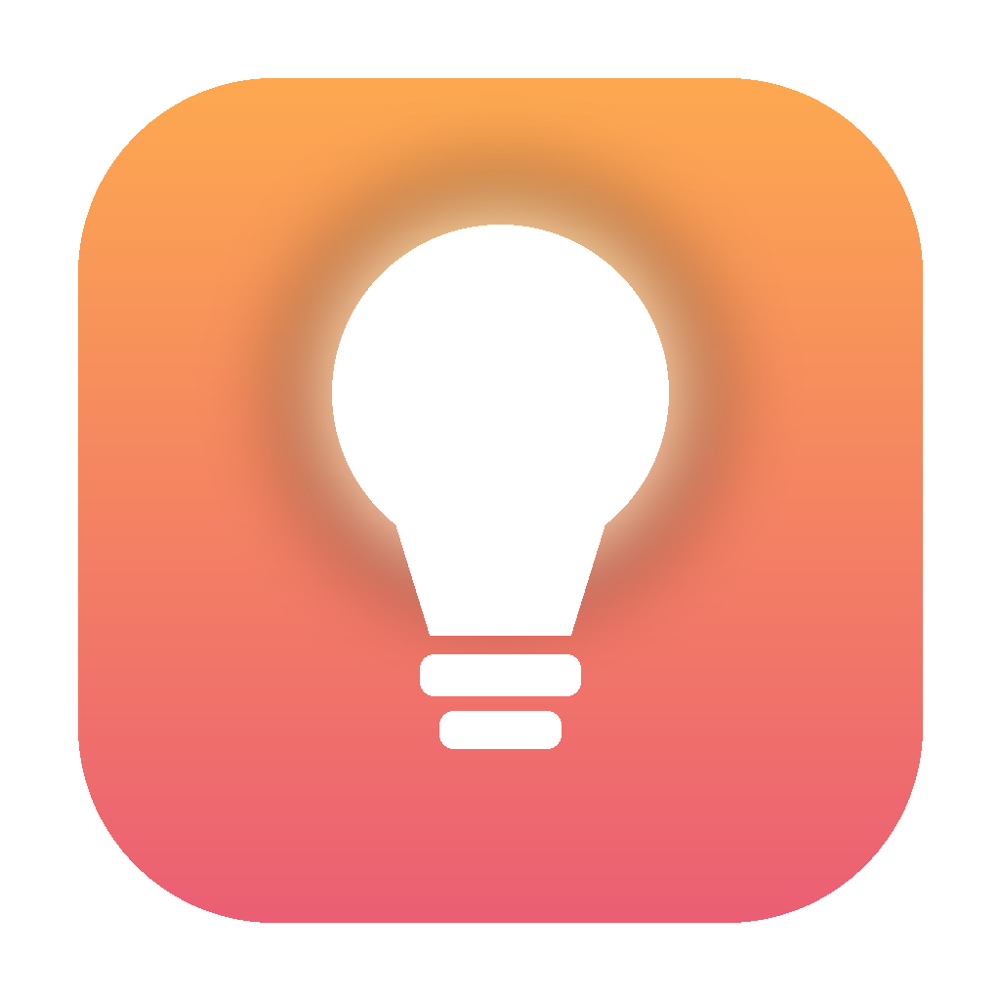

<p align="center">
  
</p>

<h1 align="center">Afterglow</h1>

<p align="center">
  <strong>Control a Bluetooth Philips Hue light from your Mac menu bar, with Siri and Apple Home. No Hue Bridge needed.</strong>
</p>

<p align="center">
  <a href="https://pellarboss.github.io/afterglow/">Website &amp; docs</a> ·
  <a href="docs/getting-started.md">Getting started</a> ·
  <a href="docs/troubleshooting.md">Troubleshooting</a> ·
  <a href="CONTRIBUTING.md">Contributing</a>
</p>

<p align="center">
  <a href="LICENSE"></a>
  
  
  <a href="https://github.com/pellarboss/afterglow/actions/workflows/ci.yml"></a>
</p>

---

Afterglow started when a power surge fried a Hue Bridge. Hue lights with Bluetooth can still be controlled directly, so Afterglow turns your Mac into the bridge: it talks to the light over Bluetooth and publishes it to Apple Home, so Siri, Control Centre and the Home app keep working.

## Features

| | |
|---|---|
| **Menu bar control** | On/off, brightness, warm ⟷ cool white, colour presets and the macOS colour picker |
| **Apple Home & Siri** | Built-in HomeKit bridge. Add it with a QR code, then use the Home app, Control Centre or Siri |
| **12 themes** | Slow, warm "Calm" palettes and faster "Energetic" ones, with brightness and colour cross-fading together |
| **macOS widget** | A desktop and Notification Centre widget showing the theme, its palette and whether the light is on |
| **Floating panel** | A live panel with the exact colour of the moment and a countdown to the next one |
| **Match Spotify** | Fades the light to the most vivid colour in the current album cover. No Spotify login or API keys |
| **Turn on at sunset** | Comes on dim and warm before sunset and brightens as it gets dark. Calculated offline |
| **Sleep aware** | Turns the light off when your Mac sleeps, and optionally back on when it wakes |

## Quick start

You need a Mac with Bluetooth, Python 3.10 or later (`brew install python@3.12`; macOS ships 3.9), the Xcode Command Line Tools (`xcode-select --install`) and a Philips Hue light with Bluetooth.

```bash
git clone https://github.com/pellarboss/afterglow.git
cd afterglow
./build_app.sh            # creates Afterglow.app in this folder
open "Afterglow.app"
```

Then pair the light:

1. In the Hue app on your iPhone: **Settings → Lights → your light → Reset** (Reset, not Delete).
2. Within a couple of minutes, click the bulb in the menu bar → **Set Up Light → Scan for Lights → Pair**.
3. Choose **Add to Apple Home…** and scan the QR code with the Home app on your iPhone.

Optional: add the macOS widget with `./build_widget.sh` (needs Xcode, signed in with a free Apple ID).

Full instructions: **[Getting started](docs/getting-started.md)**.

> The app runs the code in the folder it was built from, so keep the folder where it is.

## Documentation

- [Getting started](docs/getting-started.md): install, pair and add to Apple Home
- [Features](docs/features.md): themes, macOS widget, floating panel, Spotify matching, sunset schedule
- [Apple Home & Siri](docs/apple-home.md)
- [Configuration](docs/configuration.md): every `config.json` option
- [Command line](docs/command-line.md): `scan`, `pair` and a headless bridge
- [How it works](docs/how-it-works.md): architecture and the Hue Bluetooth GATT profile
- [Troubleshooting](docs/troubleshooting.md)

The same docs are published at **https://pellarboss.github.io/afterglow/**.

## Project layout

```
hue_menubar.py      Menu bar app (rumps)
hue_backend.py      Background engine: one asyncio loop owns Bluetooth + HomeKit
hue_homekit.py      Bluetooth light driver, HomeKit accessory and CLI
themes.py           Theme palettes and the rotation engine
desktop_widget.py   Floating panel (PyObjC)
widget_bridge.py    Feeds the macOS widget through a shared App Group file
widget/             The macOS widget: SwiftUI + WidgetKit, generated with XcodeGen
spotify_sync.py     Album-art colour matching via Spotify's AppleScript support
sunset_auto.py      Offline sunset / twilight schedule (astral)
start.sh            Creates the virtualenv and runs a command
build_app.sh        Builds Afterglow.app with a tiny native launcher
build_widget.sh     Builds and installs the macOS widget (needs Xcode)
docs/               Documentation and website (GitHub Pages)
```

## Privacy

Afterglow runs on your Mac. It talks to the light over Bluetooth and to Apple Home on your local network. The only internet request is optional: with **Match Spotify Album Art** on, it downloads the current cover image from Spotify. Your HomeKit pairing keys (`homekit.state`) and settings (`config.json`) stay in the app folder and are excluded from git.

## Contributing

Bug reports, theme ideas and pull requests are welcome. See [CONTRIBUTING.md](CONTRIBUTING.md) and the [Code of Conduct](CODE_OF_CONDUCT.md). For security issues, see [SECURITY.md](SECURITY.md).

## Licence

[MIT](LICENSE) © 2026 Roy Hui

---

<sub>Afterglow is an independent project. It is not affiliated with, endorsed by or sponsored by Signify or Philips. Philips Hue is a trademark of Signify Holding. Apple, HomeKit, Siri and macOS are trademarks of Apple Inc. Spotify is a trademark of Spotify AB.</sub>
